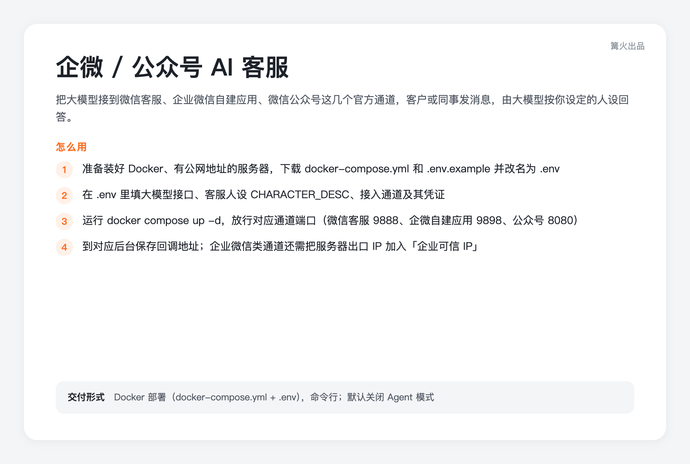

# 企微 / 公众号 AI 客服（CowAgent）

> 篝火出品 · 收录于篝火 App 应用区 · 基于开源项目 [zhayujie/CowAgent](https://github.com/zhayujie/CowAgent)（MIT）

把大模型接到**微信客服、企业微信自建应用、微信公众号**这几个官方通道，客户或同事发消息，由大模型按你设定的人设回答。只推荐这三类官方接口，不使用个人微信协议。

「转人工」说明：本工具没有自动转接人工的按钮，是靠 `CHARACTER_DESC` 里写的人设（默认写了“不确定时请客户联系人工客服”）让模型在拿不准时提示客户去找人工。

## 和「Dify 知识库客服接入器」（w05）的区别

| | 本工具（w04） | w05 Dify 知识库客服接入器 |
|---|---|---|
| 回答从哪来 | 大模型直接回答，口径靠 `CHARACTER_DESC` 人设写 | 由你在 Dify 里搭好的应用 / 知识库回答 |
| 接入通道 | 微信客服（对外部微信用户）、企微自建应用、公众号订阅号 / 服务号 | 只推荐企微自建应用 |
| 需要先搭 Dify | 不需要，只要一个大模型接口 | 需要 |
| 适合 | 想快速上线、问答口径简单、需要对外部微信用户和公众号提供客服 | 已有 Dify 知识库、答案必须来自你的资料 |

上游的「知识库」是智能体给自己整理的学习笔记，不是让你导入常见问题文档的客服知识库；要按资料回答，请用 w05。

## 部署

需要一台装好 Docker、**有公网地址**的服务器（x86 与 ARM 均可）。

1. 到 [Releases](https://github.com/campfire-code/wecom-ai-service/releases/latest) 下载 `docker-compose.yml` 和 `.env.example`，同放一个目录，把 `.env.example` 改名为 `.env`。
2. 在 `.env` 里填：大模型接口（地址、密钥、模型名，兼容 OpenAI 格式即可）、客服人设 `CHARACTER_DESC`、接入通道 `CHANNEL_TYPE` 及对应通道的凭证。
3. 运行 `docker compose up -d`。各通道监听端口：微信客服 9888、企微自建应用 9898、公众号 8080，用到哪个就放行哪个，或用反向代理转发。
4. 到对应后台保存回调地址，地址路径分别为：微信客服 `http://你的地址:9888/wxkf/`，企微自建应用 `http://你的地址:9898/wxcomapp`，公众号 `http://你的地址/wx`（容器内不能监听 80 端口，请让反向代理把 80 转到 8080）。
5. 企业微信类通道保存成功后，还要把服务器出口 IP 加到「企业可信 IP」，否则收发不了消息。
6. 各通道的凭证怎么获取，见上游文档：[微信客服](https://docs.cowagent.ai/zh/channels/wechat-kf)、[企微自建应用](https://docs.cowagent.ai/zh/channels/wecom)、[公众号](https://docs.cowagent.ai/zh/channels/wechatmp)，原文也在 `docs/zh/channels/` 下。

## 要填的配置

全部写在 `.env` 里，环境变量名按代码原样保留，企业微信、公众号后台里的官方字段名放在括号里。

| 配置项 | 说明 |
|---|---|
| `BOT_TYPE` `CUSTOM_API_BASE` `CUSTOM_API_KEY` `MODEL` | 大模型：类型（填 `custom`）、接口地址、密钥、模型名 |
| `CHARACTER_DESC` | 客服人设：回答风格、业务范围、不知道时怎么说 |
| `AGENT` | 智能体模式开关，默认 `False`（关闭） |
| `CHANNEL_TYPE` | 接入通道：`wechat_kf` 微信客服 / `wechatcom_app` 企业微信自建应用 / `wechatmp` 订阅号 / `wechatmp_service` 认证服务号，多个用逗号隔开 |
| `WECHAT_KF_CORP_ID` `WECHAT_KF_SECRET` `WECHAT_KF_TOKEN` `WECHAT_KF_AES_KEY` | 微信客服：企业 ID（CorpID）、应用密钥（Secret）、令牌（Token）、加密密钥（EncodingAESKey） |
| `WECHATCOM_CORP_ID` `WECHATCOMAPP_AGENT_ID` `WECHATCOMAPP_SECRET` `WECHATCOMAPP_TOKEN` `WECHATCOMAPP_AES_KEY` | 企业微信自建应用：企业 ID（CorpID）、应用 ID（AgentId）、应用密钥（Secret）、令牌（Token）、加密密钥（EncodingAESKey） |
| `WECHATMP_APP_ID` `WECHATMP_APP_SECRET` `WECHATMP_TOKEN` `WECHATMP_AES_KEY` | 公众号：开发者 ID（AppID）、开发者密码（AppSecret）、令牌（Token）、加密密钥（EncodingAESKey） |
| `WECHAT_KF_PORT` `WECHATCOMAPP_PORT` `WECHATMP_PORT` | 各通道的回调端口，默认 9888 / 9898 / 8080 |

## 前置条件

- 一个兼容 OpenAI 接口格式的大模型服务（地址、密钥、模型名由你自己填，密钥只存在你的服务器上）。
- 微信客服：已认证的企业微信，并开通「微信客服」，建议为它单独创建一个企微自建应用。
- 企微自建应用：企业微信管理员权限；认证企业还需要与主体一致的备案域名。
- 公众号：订阅号（个人可申请，长回答需要用户再发一句才能取到）或认证服务号（需有客服接口权限）。
- 公网可访问的服务器地址。命令行部署，没有图形界面；软件日志以英文为主，上游文档有中文版。

## 安全说明

- **默认关闭 Agent 模式**（`.env` 里 `AGENT=False`）。上游 Agent 模式下模型可以调用工具、执行命令，镜像里又是 full-access，面向外部客户时不应开启；需要请自己评估后再改。
- `.env` 里是你的密钥：只放服务器上，不要提交到公开仓库，也不要把容器日志公开发出。
- 篝火版修复了上游启动日志会把 `*_token`、密码类配置以明文打印的问题（上游只遮盖含 key / secret 的配置名），并把 8 位以下的短密钥整串遮盖。

## 验收用例

| 操作 | 应得到 |
|---|---|
| 填好企微自建应用凭证，`docker compose up -d` 后 `docker logs wecom-ai-service` | 出现 `Listening on http://0.0.0.0:9898/wxcomapp/`；日志里 token、secret、aes_key 只显示前后 3 位 |
| 在企业微信里给自建应用发一句话（已填大模型） | 收到模型按人设写的回复 |
| 用微信打开微信客服接入链接发一句话 | 收到回复 |

## 和上游的区别

- 新增中文说明与篝火发布流程（`tool.json`、`.github/workflows/release.yml`、`campfire/` 部署文件），镜像用 `docker/Dockerfile.campfire` 构建（与上游 `docker/Dockerfile.latest` 相同，仅把 `INSTALL_BROWSER` 默认改为 false，不装浏览器，镜像更小）。
- 改了 `config.py` 的日志遮盖：含 token、password 的配置也会遮盖，短密钥整串遮盖。其余代码与上游一致。
- 删除了上游的 GitHub 工作流（依赖上游的密钥）。
- 上游还支持飞书、钉钉、Telegram、个人微信等通道，本版本的部署文件只覆盖上面三类微信官方通道。

## 归属与许可证

软件全部功能与版权归 [zhayujie/CowAgent](https://github.com/zhayujie/CowAgent) 原作者所有，按 MIT 许可证分发，LICENSE 保留；第三方依赖的许可证见上游 `requirements*.txt` 对应项目。

## 上游说明

上游 README 是英文的，介绍的功能多于本版本部署文件覆盖的范围。中文版见上游文档：[CowAgent 中文说明](https://github.com/zhayujie/CowAgent/blob/master/docs/zh/README.md)，本仓库的 `docs/zh/` 下也有原文。

上游免责声明摘要：项目按 MIT 许可证发布，仅用于技术研究和学习，使用者须遵守所在地法律法规，维护者不对使用后果负责；智能体模式比普通对话消耗多得多的 token，且能访问部署机器的操作系统，只应部署在可信环境；CowAgent 是纯开源项目，不参与、不授权、不发行任何加密货币。上游原名 `chatgpt-on-wechat`，现名 CowAgent。
